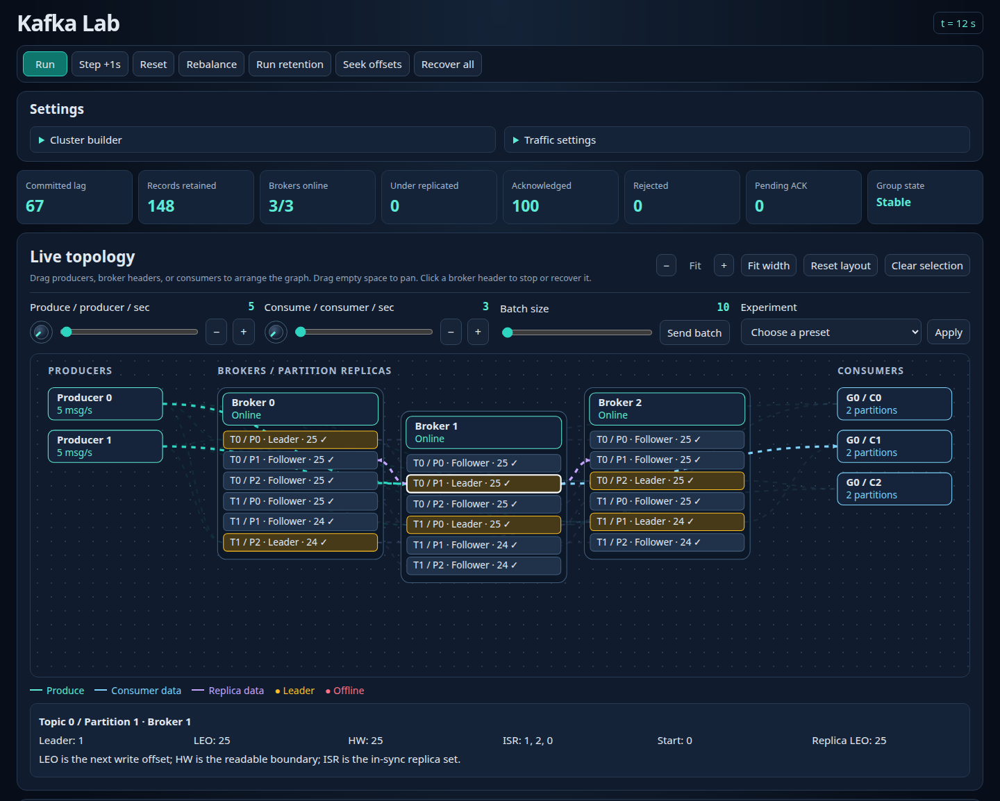
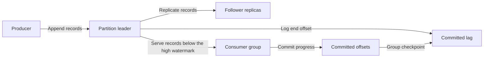

# Kafka Visual Lab

**An interactive Kafka sandbox that runs offline in your browser.**

Follow a batch from producer to partition leader, watch followers replicate it, and see consumer lag change as offsets are committed. Stop a broker or slow replication, then trace the effects through the topology, partition data, and event journal.



## Quick start

1. Download or clone this branch and open [`index.html`](index.html) from your local copy in Chrome or Firefox.
2. Select **Run** to start the simulation or **Step +1s** to advance one simulated second at a time.
3. Select a producer, partition replica, or consumer in **Live topology** to highlight its connections. Select a broker header to stop or recover that broker.
4. Drag a producer, broker header, or consumer to rearrange the graph. You can also focus one of these nodes and use **Shift + arrow keys**. Drag empty space to pan a zoomed graph, or select **Reset layout** to restore the original positions.

The lab uses plain HTML, CSS, and JavaScript and runs directly from the file. To serve it over HTTP instead, run this from the project directory and open [http://localhost:8080](http://localhost:8080).

```sh
python3 -m http.server 8080
```

## Three experiments to try

| Experiment | What to do | What to watch |
| --- | --- | --- |
| Grow lag, then catch up | Apply **Lag growing**, select **Run**, and let the simulation advance through a few commit intervals. Then apply **Catch up**. | **Consumer lag** rises when producers outpace consumers. It falls as consumers drain the backlog and commit their progress. |
| Follow a leader election | Start with the default cluster. Apply **Leader failure** and open **Kafka data → Replication / ISR**. | A broker goes offline. Partitions it led elect an available in-sync replica when controller quorum is present. Search **Event journal** for `Leader elected`. |
| Put pressure on acknowledgments | With the default cluster configuration, select **Recover all** and set **Produce / producer / sec** to 30. Apply **ACK blocked by ISR** and advance the simulation. | With `acks=all`, a write can be rejected when the in-sync replica count falls below `min.insync.replicas`. Compare **Rejected**, the journal, and the replica state. |

## Follow a record

1. Open **Kafka data → Trace a record**, choose a topic, and enter a value with an optional key.
2. Select **Send record** to submit one write directly to the simulated leader with the current `acks` setting. A repeated key stays on the same partition within its topic. An empty key uses round robin within that topic.
3. Use **Step +1s** or **Run** to see when replication acknowledges the write and which consumer in each group reads it. The partition log marks the record's offset with its trace ID.
4. Use **Show in topology** to highlight the partition's connections, or **Filter event journal** to see only that record's events.

## Compare transaction isolation

1. In **Internal systems lab → Delivery semantics**, select **Begin transaction** and **Write test batch**. The test batch goes to T0 / P0. To trace a custom record, use **Add to transaction** in **Kafka data → Trace a record**.
2. Select **Read committed** and step the simulation. In **Partition logs**, compare **HW** (high watermark) with **LSO** (last stable offset). Replication can advance HW while the open transaction holds LSO at its first offset.
3. Switch to **Read uncommitted**, select **Replay in group 0**, and step again to read the open records. Then abort and replay with **Read committed** to see those offsets skipped. Try committing a new transaction to see its records become readable in both modes.

The lab publishes a commit or abort decision when all participating writes reach their high watermarks. It represents Kafka's transaction markers as metadata on the affected offsets.

## Watch a consumer group rebalance

1. Advance until the group is **Stable**, then select a consumer in **Live topology** and note its assigned partitions.
2. Select **Stop consumer** and step through the rebalance delay. Only that group pauses. The topology reconnects each partition to its new owner when the next generation starts.
3. Check **Kafka data → Consumer groups** for owners, positions, and committed offsets. A partition that moves to a new owner resumes from its committed offset, so it can replay uncommitted work. Select **Resume consumer** to bring the member back.

The lab uses round-robin assignment across the online members in each group.

## Where to look

| Panel | What you can inspect or change |
| --- | --- |
| **Settings** | Build a cluster with different broker, topic, partition, and replication counts. Tune acknowledgments, retention, consumer groups, and commit timing. |
| **Live topology** | Follow produce, replica, and consumer data paths. Highlight connections by selecting a node, zoom into dense graphs, and run experiment presets alongside the graph. |
| **Kafka data** | Inspect partition logs, consumer positions and committed offsets, leader assignments, replica offsets, and the in-sync replica set (ISR). |
| **Internal systems lab** | Inspect producer batching and compression, broker queues and cache, log storage, consumer polling, KRaft quorum, and transaction behavior. |
| **Event journal** | Search messages or sources, filter by severity, and pause the feed to inspect events while the simulation runs. |
| **Consumer lag** | Explore committed lag across all groups or a single group. Pick a 1-, 5-, or 15-minute simulation window and compare the latest, average, and peak values. Hover over the chart or use the arrow keys to inspect a sample. |

## How the pieces connect



The **log end offset (LEO)** is the next write offset. Consumers can read records at offsets below the **high watermark (HW)**. The **committed offset** is the group's checkpoint. For each partition, the lab calculates committed lag as `max(0, LEO − committed offset)` and sums it across the selected group's partitions. **All groups** sums those totals.

Kafka Visual Lab uses a simplified, discrete model of Kafka behavior. Counters and timestamps describe the simulation, and timing is illustrative.

## Project files

| File | Responsibility |
| --- | --- |
| [`index.html`](index.html) | Dashboard markup and entry point |
| [`dashboard.css`](dashboard.css) | Responsive dashboard and monitoring styles |
| [`core.js`](core.js) | Simulation clock, cluster state, records, replication, offsets, and topology |
| [`lab.js`](lab.js) | Internal pipelines, transaction experiments, and interactive controls |
| [`monitoring.js`](monitoring.js) | Lag sampling, chart interaction, and event journal |
| [`record-trace.js`](record-trace.js) | Single-record routing, lifecycle timeline, and trace controls |
| [`transactions.js`](transactions.js) | Transaction lifecycle, last stable offsets, and consumer isolation |
| [`consumer-groups.js`](consumer-groups.js) | Group membership, rebalance timing, and partition ownership |
